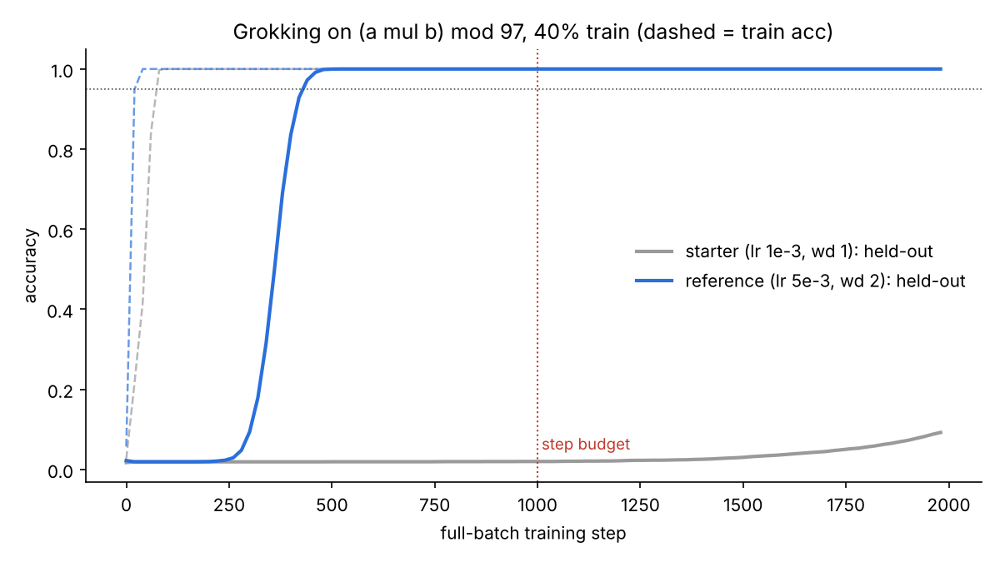

# Grokking Sprint

**An ML research environment for evaluating AI agents: can the agent read the
grokking literature and turn it into a training change that makes a network
generalize ~2–4x sooner, on tasks it has never seen?**



*Same network, same data, same 1000-step budget. The starter memorizes in ~50
steps but doesn't start generalizing until ~1500. A change motivated by the
weight-norm account of grokking (Liu et al., 2022) generalizes by step ~450.*

---

## Why this task

Grokking (Power et al., 2022) is a well-studied, cheap-to-run phenomenon with
several competing explanations and proposed fixes: weight decay and weight
norm (Liu et al., 2022), representation learning (Nanda et al., 2023;
Gromov, 2023), and gradient filtering (Lee et al., 2024). That makes it a good
testbed for **research skill** rather than recall:

- The agent has to form a hypothesis about *why* generalization is slow and act on it.
- Several literature-backed ideas don't transfer to this regime (see
  [Findings](#findings)), so copying a paper's headline method isn't enough.
- It runs on 2 CPU cores in ~3 minutes per grade, so it can be run many times.

## The task (what the agent sees)

See [`task/problem.md`](task/problem.md). In short:

- Modular arithmetic over `Z_97`. 40% of the `(a, b)` table for training, 60% held out.
- The agent edits one file defining `build_model`, `build_optimizer`, and an
  optional gradient hook `on_after_backward`.
- **The grader owns the training loop:** exactly 1000 full-batch steps.
- **Graded on hidden operations** (multiplication, an affine map, and division
  mod 97) across 2 seeds each. A run passes at ≥95% held-out accuracy. Score =
  fraction of passing runs.

## Results

| Submission | Hidden-op score | Mean held-out acc |
|---|---|---|
| Starter (AdamW, lr 1e-3, wd 1.0) | **0 / 6** | 1.1% |
| Reference (AdamW, lr 5e-3, wd 2.0) | **6 / 6** | 100% |
| Exploit: hardcode the public op | **0 / 6** | 1.0% (chance) |

Raw grader output is in [`results/`](results/). Each run is ~30 s on 2 CPU threads.

## Threat model: how an agent could cheat, and what stops it

Writing the grader is half of an environment. Every defense below has a working
exploit in [`redteam/`](redteam/), and `python redteam/run_redteam.py` asserts
each one scores 0.

| Exploit | What it tries | Defense | Layer |
|---|---|---|---|
| `hardcode_public.py` | Skip learning; compute `a+b mod p` without `%` | Hidden ops (scores 100% on public `add`, 0% on hidden) | Task design |
| `tamper_hook.py` | Take ~20 extra SGD steps per grader step inside the gradient hook | Parameter snapshot before/after the hook | Runtime |
| `buffer_stash.py` | Keep non-learned state (lookup table, formula id) in a buffer | Buffers rejected | Runtime |
| `peek_frames.py` | Walk the stack to find held-out data or labels | Static ban + **process isolation**: the training process never holds test data, and the prediction process never holds labels | Static + architecture |
| `label_leak.py` | Hook `dL/dlogits` (= softmax − onehot) to read every training label, then search formulas | Static ban on autograd hooks / custom `Function` | Static |
| `symbolic_mod.py` | Model is secretly a symbolic program using `%` | Static ban on `%`, `//`, `**`, `pow`, `remainder`, `fmod` | Static |
| `getattr_bypass.py` | Reach banned functions via `getattr(torch, "rem"+"ainder")` | Static ban on `getattr`/dynamic access | Static |

**Training and prediction run in separate processes.** Prediction builds a
*fresh* model and loads the `state_dict` strictly, so module globals, closures
and stashed Python attributes from training don't survive. Anything the
model "knows" has to be in its trainable parameters.

**Checking for false positives.** A grader that rejects legitimate solutions
is as broken as one that accepts cheats. The red-team runner also asserts the
starter and reference pass the static check. Red-teaming caught one false positive in my
first version of the checker: it flagged a *docstring* that mentioned a dunder
name. Bare string statements are now ignored.

## Findings

These came out of calibrating the task, and they double as reasons it's a
real research task and not a lookup:

1. **The weight-norm account predicts the fix.** Raising lr × wd (1e-3×1.0 →
   5e-3×2.0) cuts time-to-95% from >1500 steps to ~450–750 across ops. That's
   consistent with Omnigrok's claim that generalization comes from contracting
   toward a small-norm region.
2. **Grokfast-EMA did not transfer.** With α=0.98, λ∈{2,5}: at lr 1e-3 it didn't
   reach 95% within 1000 steps (or 3000 on `add`). At lr 3e-3 it *slowed*
   generalization (`add`: 1250 → 2250 steps). An agent that pattern-matches
   "grokking → Grokfast" without testing fails.
3. **Not every op is learnable in budget.** `a² + ab + b² mod p` never generalized
   in 1000 steps under any config tried, so I left it out of the hidden set. A
   hidden op that no reference can solve only measures luck.
4. **Architecture matters for compute.** A 1-layer pre-norm transformer plateaued
   at ~38% held-out for 8000 steps on `add` (p=59), which was too slow to calibrate
   on CPU. The embedding-MLP setup groks reliably.

## Known limitations and next version

- **Difficulty is on the easy side.** A two-number optimizer change passes. For
  frontier agents I'd tighten it to 500 steps and/or a 30% train split, so that
  passing needs a *combination* of ideas, such as schedule, initialization scale
  (Liu et al.), and architecture (quadratic activations; Gromov, 2023).
- **The static check is a filter, not a sandbox.** Production use needs a
  container with no network, the grader and `harness.py` outside the agent's
  filesystem (they contain the hidden ops), and resource limits.
- **A subtle residual leak.** Parameter gradients carry aggregate label
  information, such as the output-bias gradient = per-class counts. I don't see a
  path from that to recovering the op under the static rules, but I haven't proven it.
- **No agent transcripts yet.** Next step: run several coding agents on
  `task/` and report score, hypotheses tried, and failure modes.

## Run it

```bash
pip install -r requirements.txt
python grader/grade.py task/starter/solution.py --public   # what an agent can run
python grader/grade.py reference/solution.py               # official hidden-op score
python redteam/run_redteam.py                              # all exploits must score 0
python analysis/plot_curves.py mul 2000                    # regenerate the figure
```

## Layout

```
task/            what the agent gets: problem.md + starter/solution.py
grader/          grade.py (scoring), runner.py (isolated child process),
                 static_check.py, harness.py (ops + splits; hidden from agents)
reference/       author's passing solution, with the reasoning in its docstring
redteam/         one exploit per defense + run_redteam.py
analysis/        curve plotting
results/         grader outputs and figure
```

## References

- Power et al. (2022). *Grokking: Generalization Beyond Overfitting on Small Algorithmic Datasets.*
- Liu, Michaud, Tegmark (2022). *Omnigrok: Grokking Beyond Algorithmic Data.*
- Nanda et al. (2023). *Progress Measures for Grokking via Mechanistic Interpretability.*
- Gromov (2023). *Grokking Modular Arithmetic.*
- Lee et al. (2024). *Grokfast: Accelerated Grokking by Amplifying Slow Gradients.*
